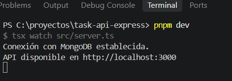
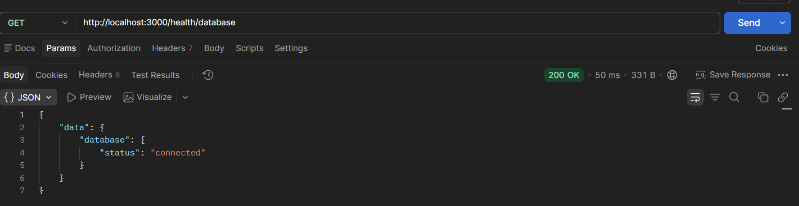
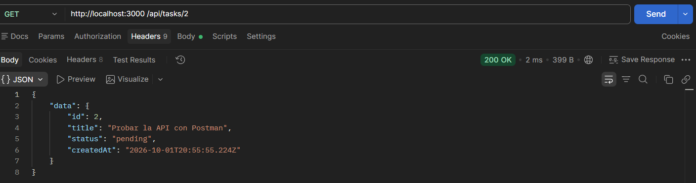
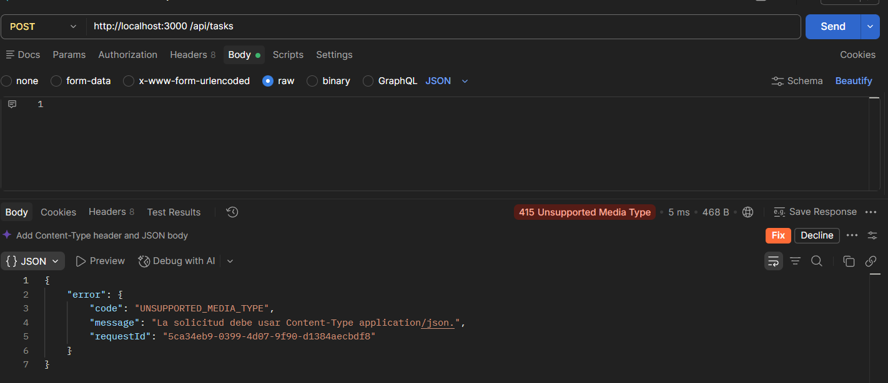
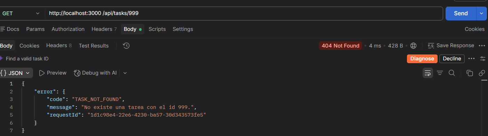
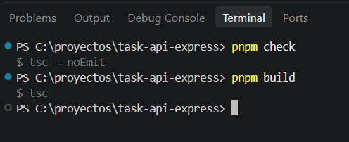
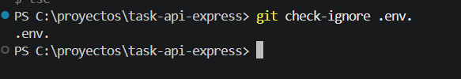
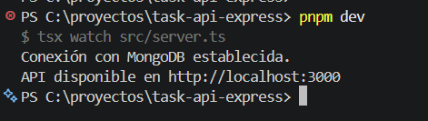

# Pruebas de conexión con MongoDB Atlas

## Entorno verificado

- Rama: feature/mongodb-atlas
- Comando de tipos: pnpm check
- Comando de compilación: pnpm build
- Resultado de arranque: conexión establecida sin mostrar credenciales

## Casos ejecutados

| Tipo            | Método y ruta                                    | Datos        | Esperado                   | Obtenido           | requestId | Resultado      |
| --------------- | ------------------------------------------------ | ------------ | -------------------------- | ------------------ | --------- | -------------- |
| Positiva        | GET /health                                      | No aplica    | 200                        | Proceso disponible |
| Positiva        | GET /health/database                             | No aplica    | 200 connected              | Ping correcto      |
| Regresión       | GET /api/tasks                                   | No aplica    | 200                        | Lista en memoria   |
| Regresión       | POST /api/tasks                                  | title válido | 201                        | Tarea Creada       |
| Negativa        | GET /api/tasks/abc                               | No aplica    | 400 INVALID_ID             | Formato Uniforme   |
| Negativa        | POST /api/tasks                                  | raw Text     | 415 UNSUPPORTED_MEDIA_TYPE | Validacion HTTP    |
| Infraestructura | Reinicio con contraseña temporalmente incorrecta | No aplica    | API no escucha             |                    | No aplica | Mensaje Seguro |

## Evidencias

1. Captura del despliegue disponible sin mostrar usuarios ni credenciales.
   
2. Captura de GET /health/database.
   
3. Capturas de una prueba correcta, una validación y una regla del negocio.
     
4. Evidencia de pnpm check y pnpm build.
   
5. Resultado de git check-ignore .env.
   
6. Prueba donde Ctrl+C termine el proceso sin un error no controlado
   
