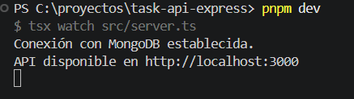
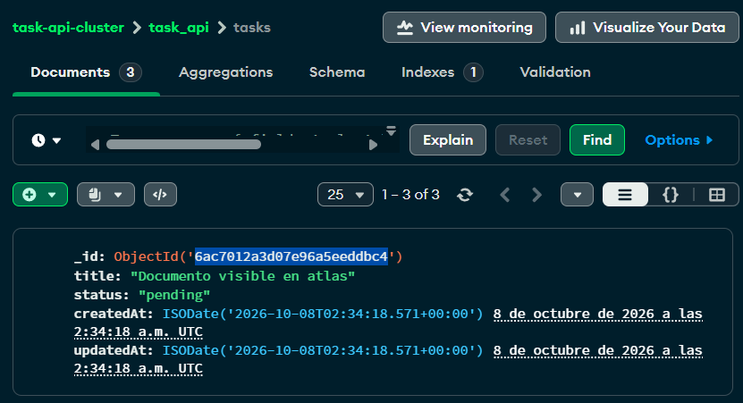
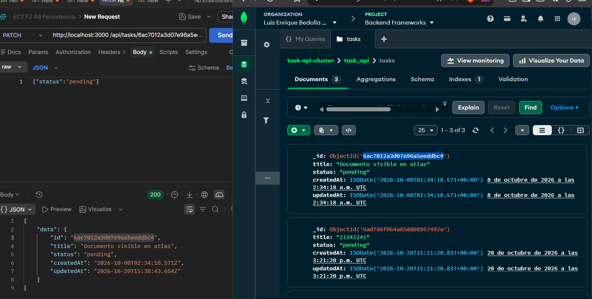
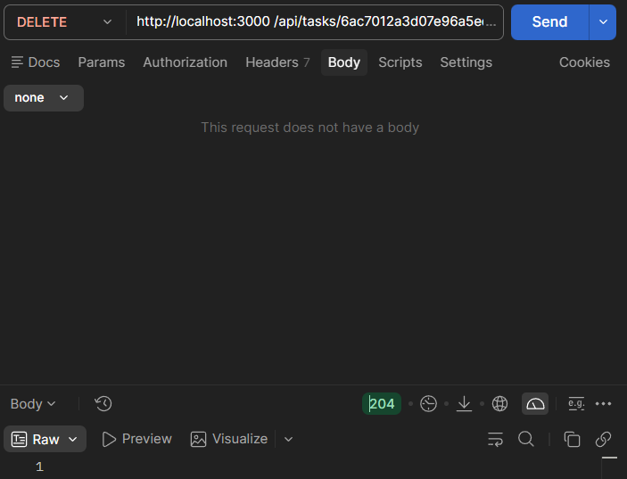
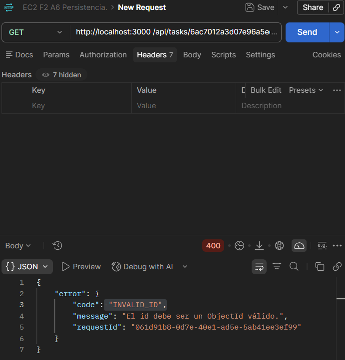

# Pruebas del CRUD persistente

## Entorno
- Rama: feature/crud-persistente-completo
- Base: task_api
- Colección: tasks
- Resultado de pnpm check:
$ tsc --noEmit
- Resultado de pnpm build:
$ tsc

## Recurso de prueba
- id devuelto por POST:
  "6ad788240fe34ef785b335c8"
- title inicial:
  "Verificar persistencia despues de reiniciar"
- title final:
  "Verificar persistencia despues de reiniciar"
- status final:
  "pending"
- Persistencia después de reiniciar:
  Los datos persistieron correctamente.

## Casos ejecutados
| Tipo | Método y ruta | Datos | Esperado | Obtenido | requestId | Resultado |
|---|---|---|---|---|---|---|
| Positiva | POST /api/tasks | {"title":"Tarea"} | 201 | | | |
| Positiva | PATCH /api/tasks/:id | {"status":"completed"} | 200 | | | |
| Negativa | PATCH /api/tasks/:id | cuerpo vacío | 422 | | | |
| Negativa | PATCH /api/tasks/:id | JSON mal formado | 400 | | | |
| Negativa | PATCH /api/tasks/:id | sin application/json | 415 | | | |
| Negativa | GET /api/tasks | Atlas no disponible | 503 | | | |
| Regresión | PATCH /api/tasks/:id/complete | sin cuerpo | 200 | | | |

## Evidencias
1. Compilación correcta.

2. Documento antes y después de PATCH en Atlas.
Antes:

Despues:

3. Respuesta 204 sin cuerpo.

4. Error de validación con requestId.

5. Consulta después de reiniciar.

