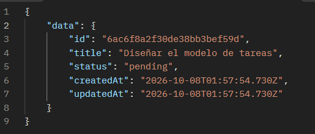
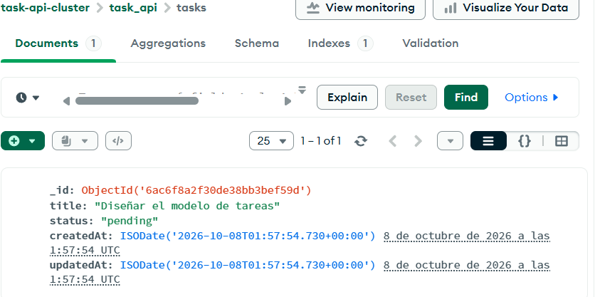
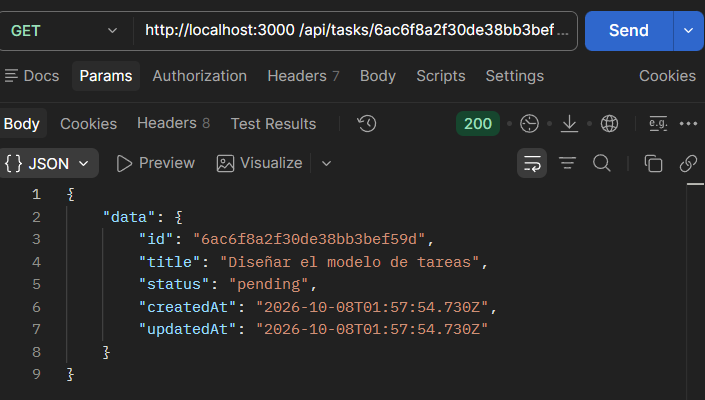
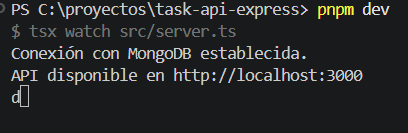
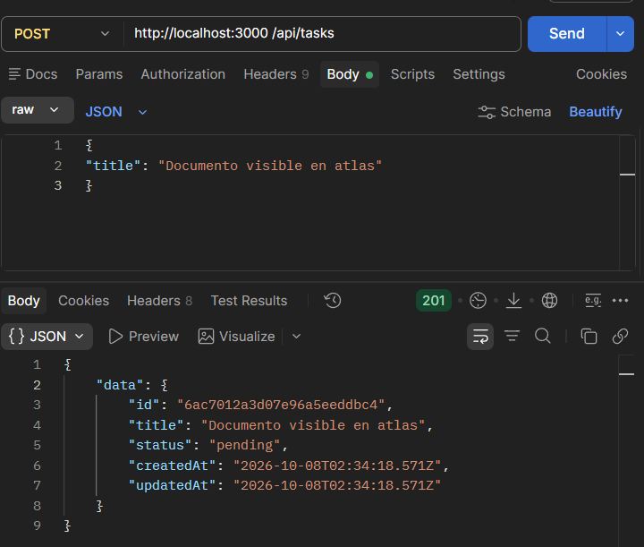
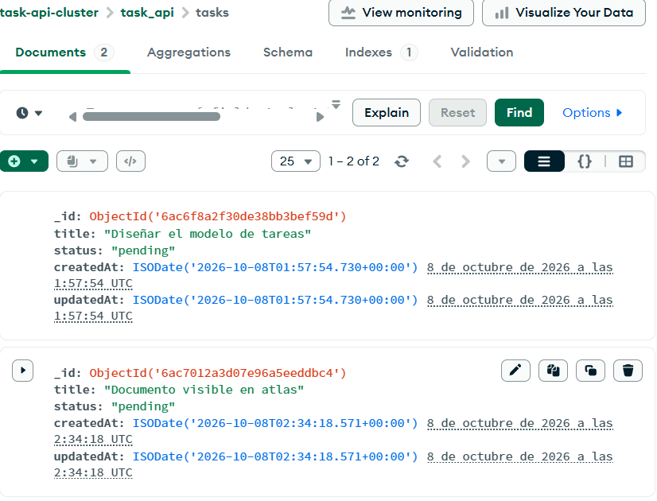
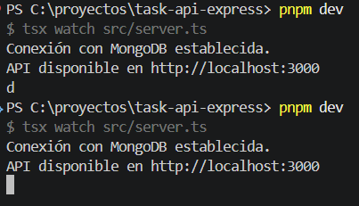
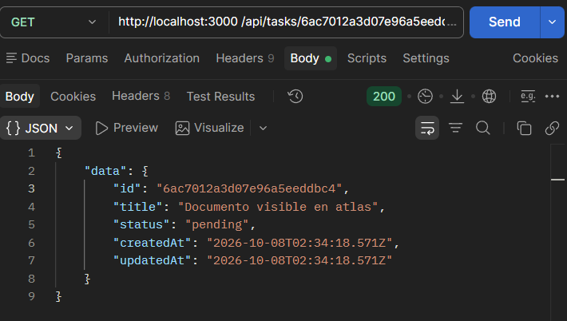

# Pruebas de modelado y persistencia

## Entorno

- Rama: feature/modelo-tareas-mongodb
- Base: task_api
- Colección: tasks
- Resultado de pnpm check:
- Resultado de pnpm build:
  

## Documento comprobado

- id devuelto por la API:
  
- Campos observados en Atlas:
  
- Resultado después de reiniciar:
  

## Casos ejecutados

| Tipo         | Método y ruta    | Datos        | Esperado       | Obtenido | requestId | Resultado |
| ------------ | ---------------- | ------------ | -------------- | -------- | --------- | --------- |
| Persistencia | POST /api/tasks  | title válido | 201            |          |           |           |
| Persistencia | GET /api/tasks   | No aplica    | 200            |          |           |           |
| Negativa     | GET /api/tasks/1 | No aplica    | 400 INVALID_ID |          |           |           |

### Pruebas de `description`

Importa la colección [task-description.postman_collection.json](../postman/task-description.postman_collection.json) y ejecútala en orden. La primera solicitud crea una tarea con texto delimitado por espacios; la segunda verifica que el GET devuelva el valor normalizado. Las demás comprueban que el campo sea opcional y que 301 caracteres produzcan `422 VALIDATION_ERROR` con `description` en los detalles.

| Tipo         | Método y ruta      | Datos                                | Esperado                                          | Obtenido | requestId | Resultado |
| ------------ | ------------------ | ------------------------------------ | ------------------------------------------------- | -------- | --------- | --------- |
| Persistencia | POST /api/tasks    | description con espacios externos    | 201; description normalizada                      |          |           |           |
| Persistencia | GET /api/tasks/:id | Tarea creada en la primera solicitud | 200; incluye description                          |          |           |           |
| Persistencia | POST /api/tasks    | Sin description                      | 201; tarea válida sin description                 |          |           |           |
| Negativa     | POST /api/tasks    | description de 301 caracteres        | 422 VALIDATION_ERROR; detalle field `description` |          |           |           |

## Evidencias

1. Compilación correcta.
   
2. POST y documento visible en Atlas sin credenciales.
   
   
3. Consulta después de reiniciar.
   
   
4. Un error HTTP, una regla del negocio y una falla de infraestructura. Las tres solicitudes y sus aserciones están en la colección [errores-y-fallas.postman_collection.json](../postman/errores-y-fallas.postman_collection.json). En Postman, importa el archivo y ejecuta las solicitudes en orden:
   - **Error HTTP - JSON mal formado**: `POST /api/tasks` con un cuerpo JSON incompleto. Esperado: `400 INVALID_JSON`.
   - **Regla de negocio - título vacío**: `POST /api/tasks` con un título compuesto por espacios. Esperado: `422 VALIDATION_ERROR`, con el detalle del campo `title`.
   - **Falla de infraestructura - MongoDB no disponible**: `GET /health/database`. Para obtener `503 DATABASE_UNAVAILABLE`, la API debe seguir ejecutándose mientras MongoDB/Atlas no esté accesible. Con la base disponible, el resultado esperado es `200`; restaura la conexión después de la prueba. Los cambios de conectividad pueden tardar unos segundos en reflejarse.

   Las pruebas verifican el estado y código de error; donde corresponde, también comprueban que `requestId` coincida con la cabecera `X-Request-Id`. Adjunta aquí capturas de cada respuesta obtenida en Postman.
